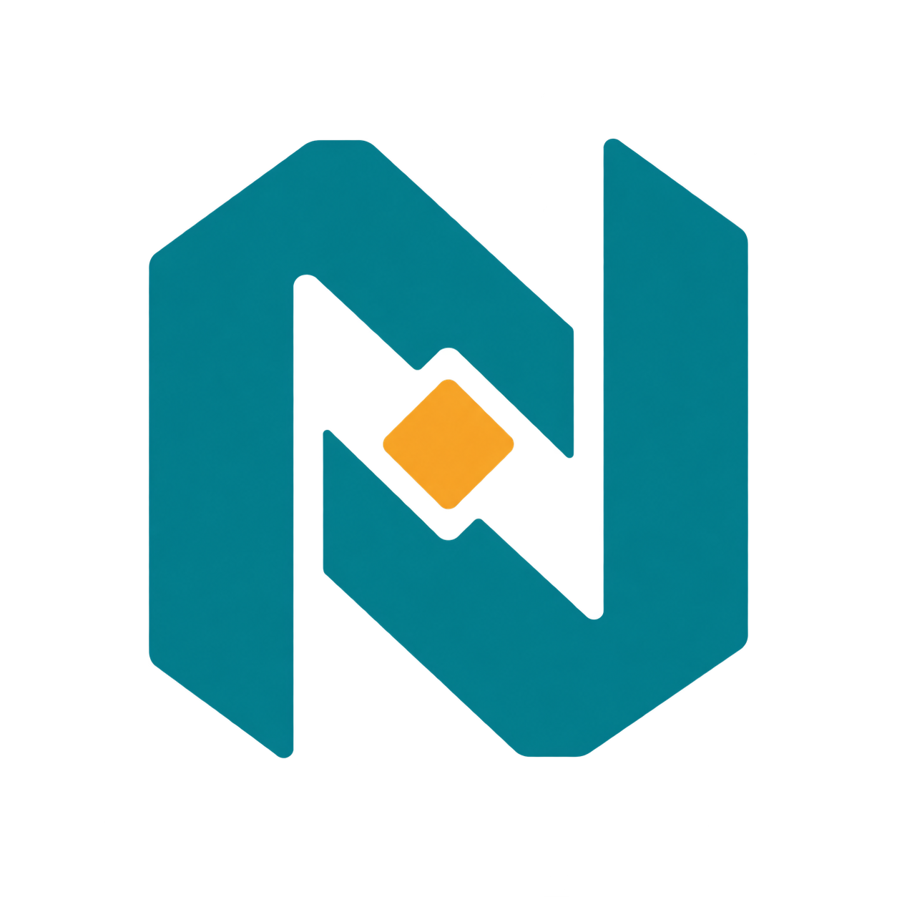

<!-- kind: guide -->
<h3 align="center"></h3>

# NUCLIS Engine

A local inference engine for open-weight models, written in Zig with a Metal
backend for Apple Silicon, and a small coding agent on top of it. It is tuned
for **Gemma 4 26B-A4B** and **Gemma 4 E4B** on an M4 Pro with 48 GB, and runs
**Qwen3.8-27B**, the dense hybrid its kernels were first written for.
Decoding reads every weight a token uses once per token, so on 273 GB/s of
memory bandwidth speed follows the parameters a token activates, not the
model's size: the 26B-A4B wakes 8 of its 128 experts, about 4B parameters,
and decodes at about 50 tokens/s where the dense Qwen3.8-27B manages 8–12.

How it is verified: every model runs first on a plain CPU reference, the
Metal kernels are checked against it, generated tiny models exercise every
weight encoding with no download (`make test-tiny`), and gates per model run
in lanes, from `make check` (seconds, no model) through `make verify-auto`
(what a change reaches) to the release tiers
([docs/development.md § Gates](docs/development.md#gates)).


*An earlier run, on Qwen3.8-27B's first pinned file: `nuclis agent` on an M4
Pro fixing a broken function in a small Python project, speculative decoding
on, pauses over 1.5 s shortened (`scripts/app/agent-demo.py`).
[engine.nuclis.dev](https://engine.nuclis.dev) replays it.*

**Status**: an experimental project, built in my free time to learn how an
inference stack works, and to learn Zig. It runs on one machine, the version
is 0.x, and breaking changes arrive without notice.

## Quick start

From source: macOS on Apple Silicon, Zig 0.17.1, and the Command Line Tools.

```sh
make metal                                              # release build, Metal backend
./zig-out/bin/nuclis model pull gemma-4-26b-a4b --all   # pinned commit, SHA-256 verified
./zig-out/bin/nuclis config init                        # ~/.nuclis/nuclis.json, from what is installed
./zig-out/bin/nuclis agent                              # the chat, with tools, in this directory
```

[Releases](https://github.com/tildaslashalef/nuclis/releases) ship the macOS
binary and an x86-64 Linux build that runs on the CPU only, for the small
models ([getting-started.md](docs/guide/getting-started.md)). `nuclis --help`
lists every command, `make help` the development targets.

## Models

The index pins each model's repository, commit, and SHA-256, so `nuclis model
pull <name>` fetches exactly the bytes that were measured.

| Kind | Name | What it is | Size |
| --- | --- | --- | ---: |
| chat | `gemma-4-26b-a4b` | Gemma 4 mixture of experts, 8 of 128 per token; the default | 14.2 GB |
| chat | `gemma-4-e4b-qat` | Gemma 4 at on-device size: per-layer embeddings, shared KV layers; hears audio | 4.2 GB |
| chat | `qwen3.8-27b` | dense hybrid: 16 attention and 48 DeltaNet layers; drafters `mtp` and `dflash2` | 16.6 GB |
| decision | `laya`, `laya-multilingual` | a small encoder that answers typed questions in one pass | 0.8, 0.6 GB |
| decision | `clef-flash` | Cloudflare's 9B decision model: long states and images | 8.0 GB |
| embedding | `embeddinggemma-2` | text, images, and audio into one vector space | 0.3 GB |
| speech | `qwen3-tts-{1.7b,0.6b}-{customvoice,base}`, `qwen3-tts-1.7b-voicedesign` | nine built-in voices, a voice cloned from a clip, or one described in words | 2.5–4.5 GB |
| speech | `drama-3` | Fish Audio's Drama 3: dialogue, delivery cues, cloned voices | 20.8 GB |
| transcription | `nemotron-asr-0.6b` | streaming recognition with punctuation and word times | 2.6 GB |

Every chat model reads images and carries a drafter, switched on where it
measured faster. **Anything else** runs when its architecture has an adapter
(Qwen3.8, Gemma 4, Muse Glimmer): finetunes, other quantizations, Prism ML's
ternary Bonsai 2. `nuclis model inspect` judges a file before the download,
and `nuclis config sync` registers what was pulled.

## Results

The 2026-10-04/05 record against the pinned llama.cpp `7620399` (Metal, flash
attention, F16 cache) on the same token arrays: Apple M4 Pro (12 CPU, 16 GPU
cores), 48 GiB, macOS 27.0.1, ReleaseSafe, 128 greedy output tokens, the mean
of three runs after a warmup, Qwen3.8 on its first pinned file. Tokens per
second, nuclis / llama.cpp, by prompt length:

| Decode | 512 | 4,096 | 16,384 | 32,639 |
| --- | ---: | ---: | ---: | ---: |
| Gemma 4 26B-A4B | 54.02 / 68.14 | 48.64 / 62.37 | 37.93 / 53.31 | 31.23 / 43.36 |
| Gemma 4 E4B QAT | 46.84 / 62.10 | 45.40 / 59.26 | 38.02 / 52.29 | 33.08 / 44.58 |
| Qwen3.8-27B (first pin) | 11.67 / 10.21 | 10.38 / 10.02 | 8.30 / 7.54 | 7.53 / 6.56 |

| Prefill | 512 | 4,096 | 16,384 | 32,639 |
| --- | ---: | ---: | ---: | ---: |
| Gemma 4 26B-A4B | 521.06 / 584.62 | 358.23 / 559.48 | 206.89 / 456.93 | 136.86 / 325.68 |
| Gemma 4 E4B QAT | 531.03 / 597.96 | 430.80 / 600.85 | 276.77 / 516.49 | 189.30 / 388.42 |
| Qwen3.8-27B (first pin) | 94.21 / 92.03 | 85.35 / 95.49 | 62.69 / 79.31 | 48.91 / 69.30 |

**Speculative decoding**: a small drafter proposes tokens and the model
checks them in one batch, keeping what it would have produced itself. Decode
off → on, greedy, at the entry's draft length (2026-10-05, median of three):

| Model | Draft | 512 | 32,639 |
| --- | ---: | ---: | ---: |
| Gemma 4 E4B QAT | 6 | 46.9 → 81.9 (1.75×) | 33.6 → 37.5 (1.12×) |
| Qwen3.8-27B (first pin) | 7 | 11.6 → 17.4 (1.50×) | 7.9 → 9.8 (1.26×) |

**Qwen3.8-27B today**, on Unsloth's re-made file: a new baseline by nuclis
alone, as every record after 2026-10 is ([2026-11-12](docs/benchmarks/history.md#the-re-made-qwen38-file-2026-11-12)), each drafter at draft 7:

| Prompt | Decode | Prefill | MTP | DFlash2 |
| --- | ---: | ---: | ---: | ---: |
| 512 | 11.79 | 94.22 | 18.46 (1.61×) | 18.18 (1.63×) |
| 4,096 | 11.41 | 86.46 | 15.98 (1.42×) | 16.81 (1.53×) |

An agent re-reads a growing prompt and writes a few hundred tokens a step.
By the tables, a 4,096-token prompt and a 200-token answer take about 16 s on
the 26B-A4B, 14 s on the E4B, and over a minute on Qwen3.8-27B: the two Gemma
models make agentic work practical on this machine, the dense 27B does not.
The 26B-A4B is work in progress: its drafter is off (0.67× at 512, as the
verify batch grows dearer with every drafted token than it saves), its decode
is 0.71–0.79× of the reference's, and its prefill falls furthest with context
(0.42× at 32,639). Speed work goes to the mixture of experts and to long
context past 32K. Method and every record: [docs/benchmarks](docs/benchmarks/README.md).

**How it got here.** nuclis began with Qwen3.8-27B, whose attention and
Gated DeltaNet layers are where the kernels were first written and tuned; it
decoded faster than the reference at every length. It stays a supported
dense model, but at 8–12 tokens/s it is too slow for an agent on 48 GB.

## Beyond chat

[docs/README.md](docs/README.md) lists every document; start with
[architecture.md](docs/architecture.md) and [llm-guide.md](docs/llm-guide.md).
Every change is a [merged pull request](https://github.com/tildaslashalef/nuclis/pulls?q=is%3Apr+is%3Amerged) with its evidence.

**Decisions.** `nuclis decide` asks Laya or clef-flash a typed question
(yes/no, a choice, a level) and gets the answer in one pass: Laya judges a
500-token log in 0.1–0.2 s ([laya.md](docs/models/laya.md), [clef-flash.md](docs/models/clef-flash.md)).

**HTTP.** `nuclis serve` keeps models open behind a local API: OpenAI's Chat
Completions (tools, images, streaming, a cache of what a conversation already
sent), TypeSafe's Jev protocol for decisions, embeddings, speech, and
transcription ([api.md](docs/guide/api.md)).

**Embeddings.** `nuclis embed` maps text, images, audio, or a mix to one
768-number vector with EmbeddingGemma 2, within `1 − cos` ≤ 5e-11 of Google's
pipeline on the BF16 file ([embeddinggemma.md](docs/models/embeddinggemma.md)).

**Speech.** `nuclis speak` (Qwen3-TTS; Drama 3 over HTTP) and `nuclis
transcribe` (Nemotron ASR, live or whole recordings) are a voice and ears
beside the language model ([api-speech.md](docs/guide/api-speech.md), [qwen3-tts.md](docs/models/qwen3-tts.md), [drama3.md](docs/models/drama3.md), [nemotron-asr.md](docs/models/nemotron-asr.md)).

## Design rules

Explicit allocators and I/O, typed errors instead of panics, bounded inputs
and outputs, and numerical correctness before optimization. Nothing is
requantized: a file the engine cannot execute exactly is refused. nuclis is
its own reference: new work is checked against its CPU reference, Metal
against that, and the same model in an encoding already validated; other
implementations are never sources to copy
([docs/models/README.md § 4](docs/models/README.md#4-validate-against-nuclis-itself)).

## Contributions

Issues are off, and the project takes no issue reports or pull requests: the
work is set by what I want to understand next. Fork freely.

## Disclosure

This code is written with heavy assistance from AI coding agents, with me
directing what gets built, deciding what counts as evidence, and keeping or
discarding the result. Their instructions are in [AGENTS.md](AGENTS.md), and
every number in the documentation was measured, never estimated.

None of it would exist without [llama.cpp](https://github.com/ggml-org/llama.cpp)
and GGML: the GGUF format is theirs, and while nuclis bootstrapped, a pinned
llama.cpp build was the oracle its first families were checked against. The
Metal bridge follows antirez's [ds4](https://github.com/antirez/ds4), which
also set the example of saying the AI part plainly. nuclis copies no code
from them; third-party material is listed in [THIRD_PARTY_NOTICES.md](THIRD_PARTY_NOTICES.md).

## Name and licence

*nuclis* plays on *nucleus*, Latin for "kernel": the small, dense core where
the mass is. MIT, see [LICENSE](LICENSE); model weights are not covered by
it, and each artifact carries its publisher's licence.
