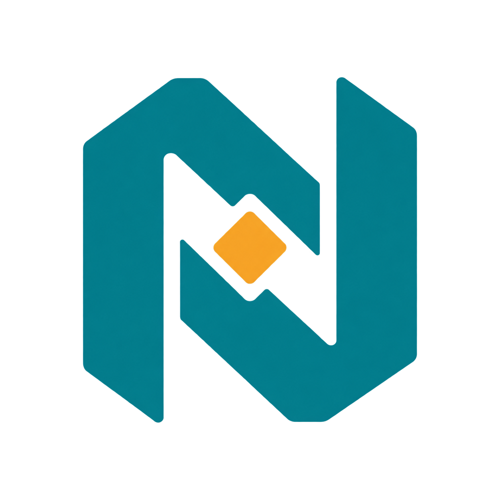

<!-- kind: guide -->
<h3 align="center"></h3>

# NUCLIS Engine

A local inference engine for open-weight models, written in Zig with a Metal
backend for Apple Silicon, and a small coding agent on top of it. On an M4 Pro
with 48 GB it is built around **Qwen3.8-27B**, the flagship: a dense hybrid of
16 attention and 48 Gated DeltaNet layers, the model its kernels were first
written for and the one its agent codes with. Beside it, **Gemma 4 E4B** is
the small, efficient brain: 4.2 GB, about 50 tokens/s, and it hears audio.

Decoding reads every weight a token uses once per token, so on 273 GB/s of
memory bandwidth a dense 27B decodes about 11 tokens/s by itself. Its DFlash2
drafter proposes up to seven tokens and Qwen checks them in one batch,
keeping exactly what it would have written: building a to-do app in `nuclis
agent`, Qwen3.8-27B wrote 18,345 tokens at **25.69 tokens/s**, 84 % of its
drafts accepted
([2026-11-20](docs/benchmarks/record/benchmarks.md#the-two-chat-models-with-their-drafters-2026-11-20)).

How it is verified: every model runs first on a plain CPU reference, the
Metal kernels are checked against it, tiny generated models exercise every
weight encoding (`make test-tiny`), and per-model gates run from `make check`
to the release tiers ([docs/development.md § Gates](docs/development.md#gates)).


*An earlier run, on Qwen3.8-27B's first pinned file: `nuclis agent` on an M4
Pro fixing a broken function in a small Python project, speculative decoding
on, pauses over 1.5 s shortened (`scripts/app/agent-demo.py`).
[engine.nuclis.dev](https://engine.nuclis.dev) replays it.*

**Status**: an experimental project, built in my free time to learn how an
inference stack works, and to learn Zig. It runs on one machine, the version
is 0.x, and breaking changes arrive without notice.

## Quick start

From source: macOS on Apple Silicon, Zig 0.17.1, and the Command Line Tools.

```sh
make metal                                          # release build, Metal backend
./zig-out/bin/nuclis model pull qwen3.8-27b --all   # pinned commit, SHA-256 verified, with its drafter
./zig-out/bin/nuclis config init                    # ~/.nuclis/nuclis.json, from what is installed
./zig-out/bin/nuclis agent                          # the chat, with tools, in this directory
```

`nuclis model pull --catalogue` fetches every model below (about 44 GB).
[Releases](https://github.com/tildaslashalef/nuclis/releases) ship the macOS
binary and an x86-64 Linux build that runs on the CPU only, for the small
models ([getting-started.md](docs/guide/getting-started.md)). `nuclis --help`
lists every command, `make help` the development targets.

## Models

The catalogue is one model per job. Each entry pins its repository, commit,
and SHA-256, so `nuclis model pull <name>` fetches exactly the bytes that
were measured.

| Kind | Name | Its job | Size |
| --- | --- | --- | ---: |
| chat | `qwen3.8-27b` | the flagship and the default: the agent's coder, with drafters `dflash2` (the default) and `mtp` | 16.6 GB |
| chat | `gemma-4-e4b-qat` | the small, efficient brain: per-layer embeddings, shared KV layers; hears audio; serves the Linux CPU build | 4.2 GB |
| decision | `laya` | fast typed answers about text, one pass per question | 0.8 GB |
| decision | `clef-flash` | typed answers about long states and images, on Qwen's own backbone | 8.0 GB |
| embedding | `embeddinggemma-2` | text, images, and audio into one vector space | 0.3 GB |
| speech | `qwen3-tts-1.7b-customvoice` | nine built-in voices that take direction ("warmly, smiling") | 4.5 GB |
| speech | `voicetut-tts` | speech model specialized in Egyptian Arabic, with Arabic–English code-switching, attribute-based voice design, and zero-shot voice cloning | 1.4 GB |
| transcription | `nemotron-asr-0.6b` | streaming recognition with punctuation and word times | 2.6 GB |

**Legacy** entries (Gemma 4 26B-A4B and 12B, Muse Glimmer, Drama 3,
multilingual Laya, the other Qwen3-TTS sizes and modes) still pull and run by
name. **Anything else** runs when its architecture has an adapter: finetunes,
other quantizations, Prism ML's ternary Bonsai 2; `nuclis model inspect`
judges a file before the download.

## Results

Apple M4 Pro, 48 GiB, macOS 27.2.1, ReleaseSafe, Metal, F16 cache. Each
record is measured against nuclis's own previous one; method and every
record: [docs/benchmarks](docs/benchmarks/README.md).

**Qwen3.8-27B, the capable one**, passes all eighteen of the agent's tasks,
where the faster Gemma 4 26B-A4B passed 72–81 % of runs
([2026-11-20](docs/benchmarks/record/agent.md#agent-long-tasks-2026-11-20)).
Its drafter writes code at 19–20 tokens/s on a short prompt and 25–29 in an
agent session writing files. Its weak side is prefill, 61–93 tokens/s: a task
spends about 108 s in the model ([2026-11-18](docs/benchmarks/record/agent.md#where-an-agent-turn-goes-2026-11-18)).
**Gemma 4 E4B, the small brain**, has six times the prefill and nearly five
times the decode in a quarter of the memory: about 35 s a task.

Tokens per second by prompt length, no drafter, 128 greedy tokens; the mean
of three runs to 16,384, one run each at 32,639 and 65,407, no swap
([2026-11-19](docs/benchmarks/record/gemma4.md#sliding-layers-on-the-materialized-body-2026-11-19)):

| Decode | 512 | 4,096 | 16,384 | 32,639 | 65,407 |
| --- | ---: | ---: | ---: | ---: | ---: |
| Qwen3.8-27B | 11.16 | 9.23 | 9.02 | 9.17 | 8.41 |
| Gemma 4 E4B QAT | 53.19 | 50.13 | 47.22 | 41.90 | 33.03 |

| Prefill | 512 | 4,096 | 16,384 | 32,639 | 65,407 |
| --- | ---: | ---: | ---: | ---: | ---: |
| Qwen3.8-27B | 93.16 | 84.02 | 77.48 | 73.17 | 61.19 |
| Gemma 4 E4B QAT | 585.95 | 551.42 | 500.96 | 437.29 | 337.20 |

**Speculative decoding**, the drafter loaded, off → on: greedy, the entry's
draft length, the median of three pairs ([2026-11-20](docs/benchmarks/record/benchmarks.md#the-two-chat-models-with-their-drafters-2026-11-20)):

| Model | Draft | 512 | 32,639 |
| --- | ---: | ---: | ---: |
| Qwen3.8-27B | 7 | 11.52 → 18.70 (1.63×) | 10.53 → 13.50 (1.29×) |
| Gemma 4 E4B QAT | 6 | 53.08 → 88.53 (1.67×) | 41.56 → 47.77 (1.15×) |

On a short code prompt with the agent's thinking sampling, Qwen's DFlash2
drafter reaches 19.30 tokens/s (1.71×; its MTP head, 17.00), and it still
pays at 65,407 (1.25×); the E4B's stops at a 32,768-token prompt by default
(`generation.draft_max_depth`, 0 never). The default context is 65,536.

**How it got here.** nuclis began with Qwen3.8-27B and decoded it faster
than llama.cpp at every length in October 2026. Gemma 4 26B-A4B, a mixture of
experts at about 50 tokens/s, led until Qwen's drafter closed enough of the
gap for its quality to lead; its gates stay, as the check of the expert path.

## Beyond chat

[docs/README.md](docs/README.md) lists every document; start with
[architecture.md](docs/architecture.md) and [llm-guide.md](docs/llm-guide.md). Every change is a [merged pull request](https://github.com/tildaslashalef/nuclis/pulls?q=is%3Apr+is%3Amerged) with its evidence.

**Decisions.** `nuclis decide` asks Laya or clef-flash a typed question
(yes/no, a choice, a level) and gets the answer in one pass: Laya judges a
500-token log in 0.1–0.2 s; clef-flash reads up to 16,384 tokens and images
([laya.md](docs/models/laya.md), [clef-flash.md](docs/models/clef-flash.md)).

**HTTP.** `nuclis serve` keeps models open behind a local API: OpenAI's Chat
Completions (tools, images, streaming, a cache of what a conversation already
sent), TypeSafe's Jev protocol for decisions, embeddings, speech, and
transcription ([api.md](docs/guide/api.md)).

**Embeddings.** `nuclis embed` maps text, images, audio, or a mix to one
768-number vector with EmbeddingGemma 2, within `1 − cos` ≤ 5e-11 of Google's
pipeline on the BF16 file ([embeddinggemma.md](docs/models/embeddinggemma.md)).

**Speech.** `nuclis speak` (Qwen3-TTS, VoiceTut-TTS) and `nuclis transcribe`
(Nemotron ASR) are a voice and ears beside the language model in `nuclis serve`
([api-speech.md](docs/guide/api-speech.md), [qwen3-tts.md](docs/models/qwen3-tts.md), [omnivoice.md](docs/models/omnivoice.md), [nemotron-asr.md](docs/models/nemotron-asr.md)).

## Design rules

Explicit allocators and I/O, typed errors instead of panics, bounded inputs
and outputs, and numerical correctness before optimization. Nothing is
requantized: a file the engine cannot execute exactly is refused. nuclis is
its own reference: new work is checked against its CPU reference, Metal
against that, and the same model in an encoding already validated; other
implementations are never sources to copy
([docs/models/README.md § 4](docs/models/README.md#4-validate-against-nuclis-itself)).

## Contributions

Issues are off, and the project takes no issue reports or pull requests: the
work is set by what I want to understand next. Fork freely.

## Disclosure

This code is written with heavy assistance from AI coding agents, with me
directing what gets built, deciding what counts as evidence, and keeping or
discarding the result. Their instructions are in [AGENTS.md](AGENTS.md), and
every number in the documentation was measured, never estimated.

None of it would exist without [llama.cpp](https://github.com/ggml-org/llama.cpp)
and GGML: the GGUF format is theirs, and while nuclis bootstrapped, a pinned
llama.cpp build was the oracle its first families were checked against. The
Metal bridge follows antirez's [ds4](https://github.com/antirez/ds4), which
also set the example of saying the AI part plainly. nuclis copies no code
from them; third-party material is listed in [THIRD_PARTY_NOTICES.md](THIRD_PARTY_NOTICES.md).

## Name and licence

*nuclis* plays on *nucleus*, Latin for "kernel": the small, dense core where
the mass is. MIT, see [LICENSE](LICENSE); model weights are not covered by
it, and each artifact carries its publisher's licence.
