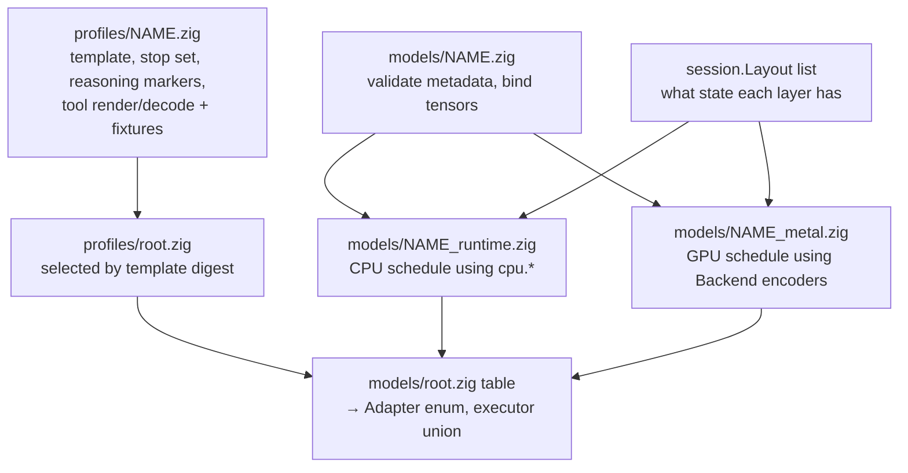

<!-- kind: reference -->
# Architecture: the rules the code keeps

How correctness is established, the Zig constructs the code leans on, how
a model is added, and the structural facts the code relies on. The map of
the engine is [architecture.md](architecture.md).

## How correctness is established

```mermaid
flowchart LR
    fx[pinned fixtures\nquant, vector, attention, recurrent JSON] --> cpu_t[CPU unit tests\nzig build test, no model]
    cpu[cpu.* references] --> cpu_t
    cpu --> gpu_t[metal-check\nzig build test-metal, no model]
    fx --> gpu_t
    tiny[generated tiny models\nevery encoding] --> tiny_t[make test-tiny\nMetal against the CPU]
    cpu -- --trace-dir --> traces[per-layer traces of the real model]
    traces -- gates.json --> full[trace and generation gates\nboth backends, both cache precisions]
```

nuclis is its own reference: the CPU reference is checked against the
format and the mathematical contract, Metal against the CPU reference, and
a new encoding of a model against one already validated. The first
families were brought up against a pinned llama.cpp build, whose fixtures
stay in the tree
([models/README.md § 4](models/README.md#4-validate-against-nuclis-itself)).

- **Unit tests** (`make test`) run without a model or GPU under a
  leak-checking allocator, including on error paths.
- **Fixtures** are a reference's outputs on small inputs, committed with
  their provenance. Decoders must match exactly; F32 GPU
  reductions match F64 sums within stated tolerances.
- **Full-model traces** compare every layer output and the logits on real
  prompts, with a documented tolerance per numerical mode.
- **Perplexity** is the long-text check the traces cannot be: `nuclis eval`
  scores windows of a pinned text teacher-forced, and each family's gate
  holds it within a stated tolerance of the pinned per-token result on the
  same tokens ([guide/eval.md](guide/eval.md)).
- **Gates and workloads are data.** Every model-specific check is a gate in
  `gates.json`, tiered by cost and selected by changed paths; every
  benchmark is a workload in `workloads.json` with its report saved by
  revision, and the record tables are generated from those reports.
- **Bench** is the only source of performance claims and reports what it
  could not measure as absent, not zero.

**Read:** [development.md § Gates](development.md#gates) and
[§ The record](benchmarks/README.md#the-record),
[benchmarks](benchmarks/README.md), [guide/eval.md](guide/eval.md),
`inference/metal-check.zig`.

## Zig constructs this codebase leans on

| Construct | Why here | Read |
| --- | --- | --- |
| Explicit allocators | No hidden heap; tests inject a leak-checking allocator | `runtime/session.zig` `init` |
| `errdefer` | Undo partial initialization when a later step fails | `engine.zig` `Engine.open` |
| `defer` with `deinit` | Release at scope exit, in reverse order | `generate.zig` `run` |
| Tagged unions with `switch` | A layer is attention *or* recurrent; both cases must be handled | `session.zig` `Layout`, `engine.zig` `Model` |
| Error sets and `try` | Expected failures are values, not panics | `quant/decode.zig` |
| Slices | Borrowed views with a length; doc comments say who owns the memory | `runtime/weights.zig` `View` |
| `comptime` and `@embedFile` | Fixtures and shader source compiled in; the IQ3_S grid becomes MSL text at compile time | `backends/metal/kernels.zig` `codebookSource` |
| `extern fn` + `*anyopaque` | Calling Objective-C through an opaque handle | `backends/metal/root.zig` |
| `extern struct` | C layout, passed as kernel constants byte for byte | `Backend.MatvecParams` |
| `std.Io` passed explicitly | File, clock, and cancellation through an injected interface | `generate.zig` `Trace` |
| `checkAllAllocationFailures` | Every allocation site fails once in a test | `session.zig` tests |
| Explicit casts | Every conversion visible and checked in safe builds | `quant/decode.zig` `half` |
| Arena allocator | Many allocations with one lifetime | `qwen35_runtime.zig` `storage` |
| `inline for` over struct fields | The configuration schema is a struct walked at compile time | `src/config.zig` |
| Callback `context: *anyopaque` | Callbacks without closures | `runtime/observer.zig`, `engine.zig` `Hooks` |
| `@Enum` / `@Union` from a table | The adapter enum and executor union are derived from one list of families | `models/registry.zig`, `engine.zig` `Executors` |
| `std.atomic.Value` + `callconv(.c)` | A Ctrl-C flag set by a signal handler, read between layers | `src/interrupt.zig` |
| Overflow-checked arithmetic | Sizes from untrusted files return `error.Overflow` | `formats/gguf.zig`, `session.zig` |
| Aligned allocation in the type | The session block is page-aligned so the GPU wraps it with no copy | `runtime/session.zig` |

The habit behind all of them: validate everything, then write nothing
until validation passes, so a failure leaves caller buffers untouched.

**Read:** the Zig language reference installed with the compiler,
[development.md § Toolchain](guide/code.md#toolchain).

## Adding a model



| You add | You do not touch |
| --- | --- |
| an adapter (`bind`, the CPU runtime, the Metal plan) and one line in `models/root.zig` `table` | `formats/gguf`, `quant`, `tokenizer/bpe`, `sampling`, `session`, `bridge.m`, the existing kernels, `generate`/`bench` |
| a profile selected by the template's digest, with fixtures from the reference server | the agent loop, the tool registry, the events, the transcript, the diff, the session log |
| genuinely new mathematics as a `cpu.*` function with fixtures plus a kernel with a `metal-check` entry | anything above or below that operation |
| a draft companion implementing `runtime/draft.zig`, when the family has one | the speculative loop |

What each family that went through the seam needed is in
[the record](benchmarks/record/architecture.md#what-the-families-needed-2026-10-28).

Registration is one line: the adapter publishes a `family` namespace
(`architecture`, `executableEncoding`, `Binding`/`bind`, `Runtime`, `Plan`)
and `models/root.zig` lists it; the `Adapter` enum, the executor union,
`model inspect`'s verdict, and `nuclis validate` derive from that table.
Profiles register the same way and own everything template-specific: the
stop set, the reasoning markers, and the tool path in both directions.
Nothing under `src/` names an adapter or a profile module.

**Read:** [models](models/README.md)
(the order of work), [engine/prompt-profile.md](engine/prompt-profile.md),
[engine/tool-calling.md](engine/tool-calling.md),
[llm-guide.md § 24–§ 25](llm-guide.md#24-the-registry-table).

## Structural facts the code relies on

Each is enforced or documented in the file it names.

- **Kernel binding convention:** data buffers at indices 0–6, the
  parameter struct at 7. The `Backend` encoders in `backends/metal/ops/`
  are the only place that knows kernel names and argument order.
- **Specialized matvecs** are chosen per encoding when `specializedMatvec`
  accepts the row alignment; `rows_per_simdgroup` and
  `simdgroups_per_matvec_group` must match the kernel template constants.
- Every `Backend` function starts with `if (!enabled) return
  error.MetalNotEnabled;` so non-Metal builds link.
- `Observer` has three optional callbacks: `check` (no activations, runs
  while recording), `layer` (activations, forces a commit per layer, trace
  runs only), `progress` (a call per chunk and per token). Never install
  `layer` on a production path.
- `Backend.tick` is called from `commit` only while a buffer runs longer
  than 100 ms, on the calling thread, and must not touch the backend or
  the model.
- **Profiling** uses one encoder per dispatch because Apple GPUs stamp only
  encoder boundaries; stamps are nanoseconds on the `GPUStartTime`
  timeline; a profiled run's tok/s is not comparable.
- Weights are wrapped per tensor, not as one buffer (one buffer made GPU
  time swing 3–4×; documented in `models/qwen35_metal.zig`).
- `Session` is one page-aligned block with typed views; attention rows are
  F32 or F16 by layout, recurrent state F32, regions on 16-byte boundaries.
  `snapshot`/`restore` require an equal layout digest and capacity; a
  checkpoint region and per-row recurrent checkpoints serve the
  speculative batch. **GPU-idle invariant:** no command buffer in flight
  when the CPU touches session memory.
- Prefill chunk buffers hold `matmulPadded(chunk)` rows; `nu_attention_chunk`
  reads exactly `position + count` cache rows; a nonzero `window` masks
  per row and the caller may slice the cache at the earliest visible key;
  value widths above 256 take one threadgroup per 256 columns.
- Decode attention is `nu_attention_decode` + `nu_attention_merge`: grid
  (KV head, head group, split), each cache row read once per head group;
  the `_w`/`_wh` instantiations serve widths up to 512.
- Metal's `tanh` returns NaN past about ±44; every kernel goes through
  `nu_tanh`, clamped at ±20 where F32 tanh is exactly ±1.
- A plan's `deinit` calls `Backend.unwrap` on its session memory: `wrap`
  caches by address and refuses a second length at the same address.
- The DeltaNet GPU update is nontransactional; correctness after a failure
  relies on `Session` poisoning until `reset()`.
- **Speculation:** `verify` feeds `1 + k` rows through the prefill path with
  every row's logits (or the device top-k per row) retained; acceptance
  draws the target's own token per row; recovery is a slot copy. A draft
  source is a session layout like any layer.
- **Sampling:** `sampling.History` is session state owned by the caller
  and reset wherever the session is; the sampler is policy only; the
  per-mode defaults live in the profile. A penalty runs through the device
  kernel before the top-k.
- **Adapters and profiles are tables.** `models.table` builds the enum, the
  union, and the known list; `profiles.forDocument` picks by template
  digest; the stop set and the completion decoder are the profile's.
- **The terminal surface** imports nothing from `inference`; only
  `tui.terminal` touches the OS and only `tui.screen` emits a movement
  escape, which is why its golden tests need no TTY. The agent's typed
  events are consumed three times: the transcript (each closed block
  written exactly once), the status bar, and print mode.
- **Decided:** F16 KV is the GPU default and the CPU reference stays F32;
  greedy decode uses GPU argmax; sliding caches are allocated for the full
  capacity; the ternary matvec keeps its arithmetic.

**Read:** [engine/metal-backend.md](engine/metal-backend.md),
[engine/session.md](engine/session.md), `runtime/session.zig`.
