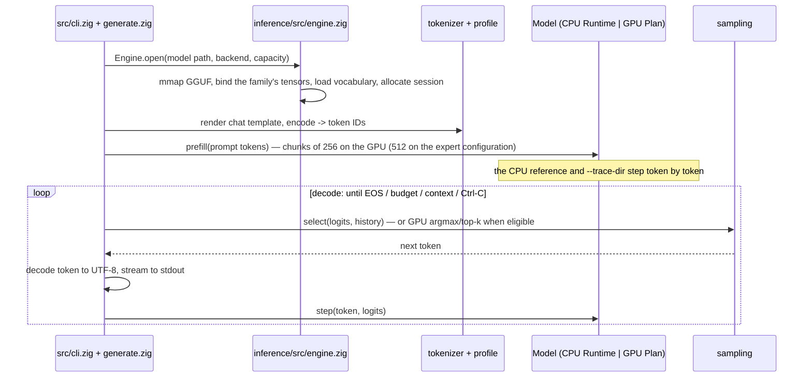
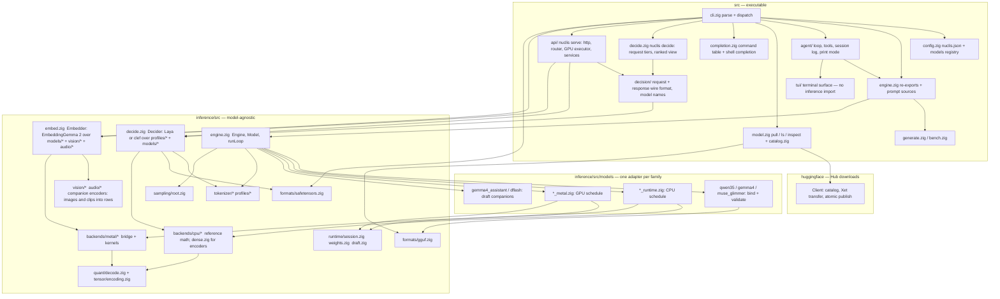
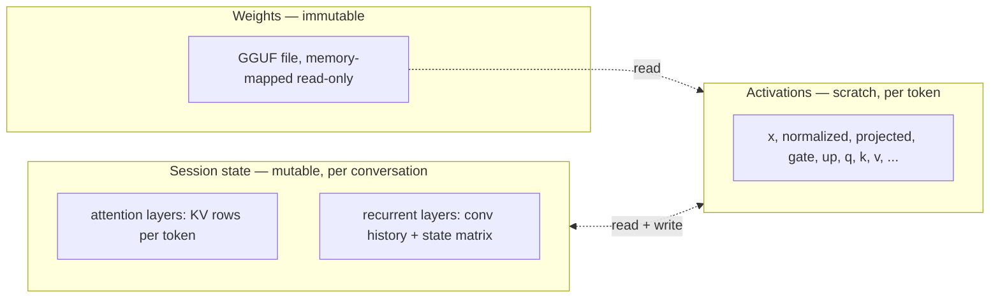
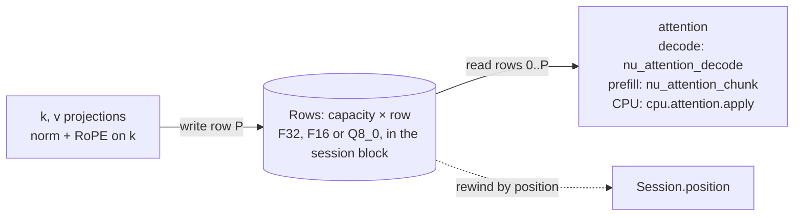
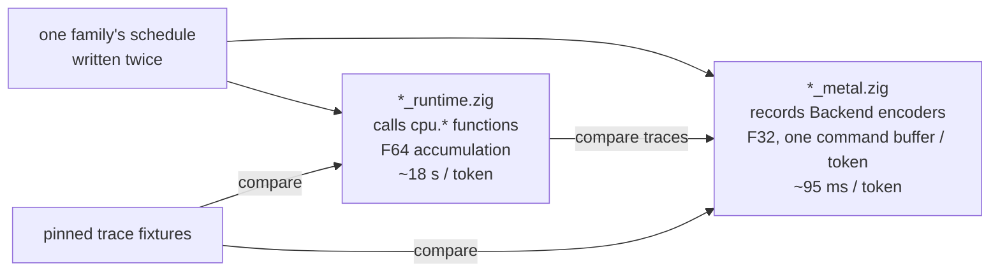
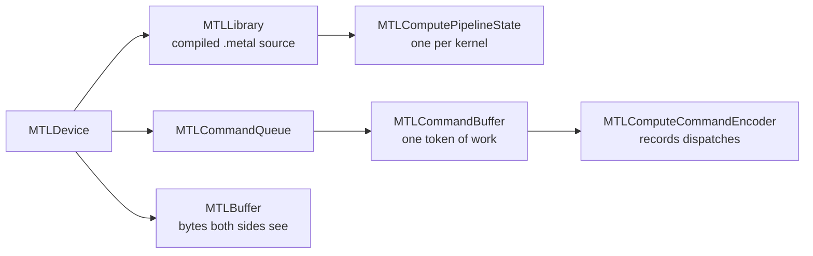

<!-- kind: reference -->
# nuclis architecture guide

The map of the engine: what the pieces are, how a token flows through them,
and where each idea lives so you can read the code next. Sections are short
by design and end with **Read** pointers; the reasoning behind the design,
with its measurements, is in [llm-guide.md](llm-guide.md), and the facts
per component are in the documents [README.md](README.md) lists.

nuclis has two components: the engine library under `inference/`, and the
executable under `src/`, which embeds the `generate`/`bench` CLI and the
`nuclis agent` surface on top of the engine. This guide follows the engine;
the agent appears where it touches the same interfaces. The paths beside
the token loop (decisions, embeddings, the HTTP API) are
[architecture-paths.md](architecture-paths.md); how correctness is
established, the Zig constructs the code leans on, how a model is added,
and the structural facts the code relies on are
[architecture-rules.md](architecture-rules.md).

1. [What happens when you run `nuclis generate`](#1-what-happens-when-you-run-nuclis-generate)
2. [The repository as layers](#2-the-repository-as-layers)
3. [Three kinds of memory](#3-three-kinds-of-memory)
4. [One Qwen layer](#4-one-qwen-layer)
5. [The KV cache, end to end](#5-the-kv-cache-end-to-end)
6. [Two executors, one schedule](#6-two-executors-one-schedule)
7. [Metal for a Zig programmer](#7-metal-for-a-zig-programmer)
8. [Where performance goes](#8-where-performance-goes)

## 1. What happens when you run `nuclis generate`



- **Prefill** consumes the prompt in chunks through batched kernels; only
  the last token needs logits. **Decode** feeds each generated token back
  through `step`. The session state (§3) is what makes the second token
  depend on the first.
- **Speculative decoding** replaces the step with a batch: a draft source
  proposes `k` tokens, one `verify` forward scores them all, the accepted
  prefix is kept and the session recovered to it. The switch is per
  catalogue entry ([engine/speculative-decoding.md](engine/speculative-decoding.md)).
- The CLI owns presentation, files, timing, and cancellation, never
  weights or math. The loop, `Engine`, and the `Model` union live in the
  library so `generate`, `bench`, and the agent share one API; the
  executable reaches in through `Hooks`, the layer `Observer`, and the
  Metal backend's `tick`.
- A token is an integer id into the vocabulary; text exists only at the
  edges (`tokenizer/encode.zig` in, `tokenizer/stream.zig` out).

**Read:** `inference/src/engine.zig` (`runLoop`, `speculativeBatch`),
[engine/sampling.md](engine/sampling.md).

## 2. The repository as layers



**Arrows only point down.** Shared modules never import an adapter;
adapters never import the executable. `models/` is the one place that knows
a family by name; `src/` is the one place that knows files, terminals,
signals, and the network.

| Layer | Knows about | Must not know about |
| --- | --- | --- |
| `formats/gguf` | bytes, offsets, metadata types | what a tensor name means |
| `formats/safetensors` | the JSON header, dtypes, the tiled byte buffer, a shard index ([reference](engine/safetensors.md)) | what a tensor name means; Laya's loader (`models/laya.zig`) binds it |
| `quant`, `tensor` | block layouts, decode equations | which tensor is which |
| `tokenizer`, `profiles` | vocabularies, merges, the chat template, tool grammar | layers, kernels |
| `runtime/session` | "a layer has KV rows" or "recurrent state" | how big, or why |
| `runtime/draft` | that a family can propose tokens and advance over committed ones | how it predicts |
| `backends/cpu`, `backends/metal` | one operation at a time, shapes as parameters | layer order |
| `models/*` | everything above, composed in one family's order | terminals, files |
| `engine` | composing adapters, backends, tokenizer, sampler into `open`/`step`/`runLoop` | files, terminals, signals |
| `decide` | picking a decision family by the checkpoint's files and composing its tokenizer, profile (contract, calibration), and model into `open`/`parseQuestion`/`decide` | files beyond its location (directory, backbone, projector), terminals, the text engine |
| `src` | arguments, configuration, stdout, Ctrl-C, presentation, downloads | equations |
| `src/decision` | the decision request and response JSON, resolving a decision model's name | HTTP, terminals |
| `src/api` transport and router (`http.zig`, `router.zig`) | connections, HTTP/1.1, routes, the error body | models, `inference` |
| `src/api` services (`decisions/`, `chat/`) | validating a request, waiting for the GPU, rendering the answer | sockets; a model except through the GPU executor |
| `src/web` | the search service's v1 contract, its HTTP client, the web tools' definitions and the text their results become, for the agent and `chat/` | models, terminals, the GPU |
| `huggingface` | the Hub API, Xet reconstruction, digests, atomic publication | what a GGUF means |

**Read:** [spec.md § Extension rules](spec.md#57-extension-rules),
[development.md](development.md).

The decision path, the embedding path, and the API layer:
[architecture-paths.md](architecture-paths.md).

## 3. Three kinds of memory



| Kind | Where | Owner | Lifetime | Zig type |
| --- | --- | --- | --- | --- |
| Weights | the file, mapped by `runtime/weights.zig` | `Mapped` | the process | `[]const u8` views, never expanded |
| Session state | one page-aligned block, `runtime/session.zig` | `Session` | until `reset()` | `Rows` (F32 or F16 KV rows), `[]f32` recurrent state; a draft source's cache is one more layout |
| Activations | arena (CPU) or GPU buffers (Metal) | the executor | one `step` | scratch |

- **Weights stay quantized.** A kernel decodes each block on the way into
  the multiply; there is never a floating-point copy of the model.
- **Session state is not only a KV cache.** Recurrent layers hold a matrix
  overwritten in place every token; it cannot be rewound by truncating a
  length. The session offers `snapshot`/`restore` and, inside a speculative
  batch, `checkpoint`/`rewind`/`truncate`.
- **The session is a state machine**: `ready → updating → ready`, or
  `failed` until `reset()`, so a half-finished token is never mistaken for
  committed state.

**Read:** [engine/session.md](engine/session.md),
`runtime/session.zig`, `runtime/weights.zig`.

## 4. One Qwen layer

```mermaid
flowchart TB
    xin[x in] --> n1[RMSNorm × attention_norm]
    n1 --> mixer{layer % 4 == 3 ?}
    mixer -- yes --> attn[Full attention]
    mixer -- no --> delta[Gated DeltaNet]
    attn --> add1[x += projected]
    delta --> add1
    add1 --> n2[RMSNorm × post_attention_norm]
    n2 --> ffn[gate = W_gate·n, up = W_up·n\ngate = silu(gate) · up\nprojected = W_down · gate]
    ffn --> add2[x += projected] --> xout[x out]
```

- **Full attention** (16 of 64 layers): project q with its gate, k, v;
  norm and RoPE q and k; write k/v at the current position; attend over
  the visible prefix with 6 query heads per KV head; gate; project out.
- **Gated DeltaNet** (48 layers): project qkv, z, β, α; a causal
  convolution over the last 4 inputs; L2-normalize q and k; per head,
  update a 128 × 128 matrix (`S ← a·S; S += β·(v − S·k)·kᵀ; out = S·q`);
  norm × `silu(z)`; project out.
- In prefill both mixers are batched over a chunk: attention as a causal
  tile, DeltaNet through its chunkwise form.

The other families on the same wrapper:

| Family | Layers | Mixers | What is different |
| --- | --- | --- | --- |
| Gemma 4 12B | 48 | sliding-window attention (1,024) and global attention with 512-wide heads | tanh GELU, RoPE factors, scaled residuals, capped logits ([models/gemma4.md](models/gemma4.md)) |
| Gemma 4 26B-A4B | 30 | as the 12B | the feed-forward is 128 experts, 8 active per token ([models/gemma4.md § 26B-A4B](models/gemma4.md#the-26b-a4bs-expert-layer)) |
| Muse Glimmer 30B | 52 | 39 windowed (2,048), 13 global | dense; the `llama4` tokenizer splitter ([models/muse-glimmer.md](models/muse-glimmer.md)) |
| Bonsai 2 27B | 64 | Qwen's | ternary weights in a Hadamard-rotated basis ([models/bonsai.md](models/bonsai.md)) |

**Read:** [engine/cpu-reference.md](engine/cpu-reference.md) (the
equations and tolerances), `models/qwen35_runtime.zig` (`fullAttention`,
`linearAttention`), [llm-guide.md § 9](llm-guide.md#9-attention-reads-deltanet-writes).

## 5. The KV cache, end to end

The cache is not a module. It is a storage contract in the session,
written by each adapter's two schedules, read by the attention kernels.



| Step | Where |
| --- | --- |
| Declared | `Layout.attention { key_row, value_row, precision }` per layer; the session carves `capacity` key rows and value rows from the block (`runtime/session.zig`) |
| Viewed | `Rows.range(first, count)`: the byte range a GPU binds; `Rows.floats(first, count)`: the F32 view the CPU reads (asserts F32) |
| Written | after the key norm and RoPE, at row `position`: `fullAttention` on the CPU; the Metal plan projects into the slot (F32) or through scratch and `Backend.storeRows` (`nu_pack_half`, `nu_pack_q8_0`); prefill writes a chunk of rows |
| Read | rows `[0, position + 1)`, or a window's suffix: `nu_attention_decode` (each row once per KV head group, online softmax in registers), `nu_attention_chunk` (a chunk tiled against the visible rows; a Q8_0 cache is expanded to F16 for it first), `cpu.attention.apply` |
| Rewound | by position: rows past it are never read, so `Session.truncate` is a number, not a copy; recurrent layers cannot do this |

The precision is `engine.kv_precision`, F16 by default on the GPU: half
the block and half the bytes each decode step streams, at a rounding the
trace gates bound per mode. `--kv q8_0` takes about half again (blocks of
32 values with an F16 scale); `--kv f32` is for numerical work.

**Read:** [engine/session.md](engine/session.md),
[llm-guide.md § 20](llm-guide.md#20-half-the-bytes-the-f16-cache) and
[§ 21](llm-guide.md#21-flash-decoding), `Backend.attentionDecode` and
`attentionChunk` in `backends/metal/ops/attention.zig`.

## 6. Two executors, one schedule



- `*_runtime.zig` is the **reference**: plain loops, F64 sums, every
  operation a pure function in `backends/cpu/` with its own tests. Slow on
  purpose; when the two disagree it is presumed right. The exception is
  `modernbert_runtime.zig`, Laya's encoder: its F32 forward is the product
  path on the CPU (SIMD, split across `Io` tasks, `backends/cpu/dense.zig`),
  and the F32 fixtures pinned from the `laya` package are its reference
  ([laya.md](models/laya.md)).
- `*_metal.zig` is the **engine**: the same schedule, each line recording
  a dispatch; nothing runs until `commit()`. The files are deliberately
  parallel so they can be read side by side.
- `engine.zig` wraps both in a `Model` union with `step`, `prefill`,
  `prefillRows` (every row's logits, for `eval`), `verify`, and `reset`,
  so callers never care which is underneath.
- The schedule is written twice by decision. Three families showed that
  what varies between them is parameters and instantiations of existing
  kernels, not operation order, so a shared op list was not extracted.

**Read:** [engine/metal-backend.md § Execution model](engine/metal-backend.md#execution-model),
[engine/sampling.md § Numerical traces](engine/sampling.md#numerical-traces).

## 7. Metal for a Zig programmer



| Metal object | Our name | Where |
| --- | --- | --- |
| device, queue, library, pipelines, buffers, the current command buffer and encoder | `NuMetal` | `bridge.m` |
| `nu_metal_create` / `_destroy` | `Backend.init` / `deinit` | `root.zig` |
| `nu_metal_pipeline(name)` | compiled once per kernel at init | `root.zig` `kernel_names` |
| `nu_metal_buffer_create` / `_wrap` | `Backend.create` / `wrap` → `Buffer{id, offset, len, host}` | `root.zig` |
| `nu_metal_begin` / `_dispatch` / `_commit` | `Backend.begin` / typed encoders / `commit` | `root.zig` |

- **A kernel is a function run by many threads at once.** Zig chooses the
  grid and thread count and holds the constants the kernels assume; only
  `backends/metal/kernels/` names a lane or a SIMD group. The three kernel shapes
  (reductions, tiles on the matrix unit, elementwise) and every kernel's
  geometry are tabulated in [engine/metal-kernels.md § Kernel geometry](engine/metal-kernels.md#kernel-geometry).
- **Unified memory.** The GPU addresses the mapped file and the session
  block directly through `newBufferWithBytesNoCopy`, page-aligned, with no
  copy. The mapping must outlive the backend.
- **Synchronization is a cost like bandwidth.** One command buffer per
  token; the CPU may touch session memory only after `commit()` returns.
  The wait is a semaphore with a 100 ms timeout that calls the backend's
  optional `tick`, which is how the agent repaints during a long prefill
  chunk at no cost to a decode step.
- Objective-C appears only in `bridge.m`, without automatic reference
  counting, so every retain and release is explicit.

**Read:** [engine/metal-backend.md](engine/metal-backend.md),
[llm-guide.md § 11–§ 13](llm-guide.md#11-crossing-the-bridge), `bridge.m`,
then `kernels/rowwise.metal` (`nu_add`, `nu_rmsnorm`) before `kernels/matvec.metal`.

## 8. Where performance goes

Decode is bound by reading weights: 16.1 GB per token over a 273 GB/s bus
is about 59 ms, a ceiling near 17 tok/s.

The milestones that took decode from 2.3 tok/s to the current rates, and
the 2026-10-04 comparison with the pinned llama.cpp, are in
[the record](benchmarks/record/architecture.md#the-decode-and-prefill-milestones-2026-10-04);
the current rates are the README's [Results](../README.md#results).

Levers that were built, measured, and kept out, each with its table in the
record: a multi-row matvec that wins only at 2–3 rows, a wider small-batch
tile, a split-K matvec, register-reuse prefill attention (shipped only for
chunks of 17–64 rows; verify batches of up to 16 take the split pass of
[few-query verify attention](engine/metal-attention.md#few-query-verify-attention)), fused decode norms (shipped
for the dispatch count, not for speed), and speculation on the 26B-A4B,
whose verify grows with every drafted row (each row routes to its own
experts) until it costs more than the accepted drafts save. The other
entries speculate by default.

**Read:** [benchmarks](benchmarks/README.md),
[engine/metal-backend.md](engine/metal-backend.md),
[engine/apple-gpu.md](engine/apple-gpu.md) (the GPU's counters on our kernels),
[llm-guide.md § 13](llm-guide.md#13-the-matvec-that-reads-16-gb) and
[§ 23](llm-guide.md#23-guessing-ahead-and-paying-to-check).
