<!-- kind: record -->
# Architecture: the record

The dated history behind [the architecture guide](../../architecture.md) and
[its rules](../../architecture-rules.md), kept as written.

## What the families needed (2026-10-28)

What the families that went through the seam actually needed:

| Case | New | Reference |
| --- | --- | --- |
| Gemma 4 12B | `cpu.gelu`, RoPE factors; on the GPU four scalar epilogues, a GELU pair mode, a window parameter on the chunk attention, a wider instantiation of decode attention, a `tanh` clamp | [gemma4.md](../../models/gemma4.md) |
| Gemma 4 26B-A4B | not a second adapter: `gemma4.configs` selects by block count; `cpu.experts` and the gathered kernels; `weights.View.expertMatrix`; a per-plan `preferredChunk` | [gemma4.md § 26B-A4B](../../models/gemma4.md#the-26b-a4bs-expert-layer) |
| Q4_0 (the QAT file) | a `quant.row` arm, a generic GPU decoder, a specialized matvec and tile, the adapter's `executableEncoding` claim | [gemma4.md § Q4_0 path](gemma4.md#q4_0-path-and-the-qat-file-2026-09-12) |
| Q5_0, Q5_1 (K-quant files' `ffn_down`) | the same four pieces, one templated body for both, and the gathered expert tile | [quantization.md](../../engine/quantization.md#equations-and-evidence) |
| Muse Glimmer 30B | a tokenizer splitter, a windowed schedule with global layers, a profile with a reasoning channel and its own tool grammar; no new kernel | [muse-glimmer.md](../../models/muse-glimmer.md) |
| Bonsai 2 27B | two ternary encodings, the Hadamard transform, a rotation contract in the Qwen adapter; the Qwen plan otherwise | [bonsai.md](../../models/bonsai.md) |
| draft sources | Qwen's `nextn` block, embedded or from its `MTP/` companion (`qwen35.bindDraft`); `gemma4_assistant.zig`, a second GGUF reading the target's caches; `dflash.zig`, a block drafter | [speculative-decoding.md](../../engine/speculative-decoding.md) |

## The decode and prefill milestones (2026-10-04)

```mermaid
flowchart LR
    m1[sync per-op bridge\n2.3 tok/s] --> m2[one command buffer / token\n5.0] --> m3[specialized matvec\n8.5] --> m3b[no per-layer commits\n9.7] --> m4[Q3_K/IQ3_S kernels,\nmerged projections\n10.6] --> m6[GPU sampling\nsampled = greedy speed] --> p1[chunked prefill matmul\n11 → 51 tok/s at 512] --> p2a[tiled causal attention\n33 → 51 at 4K] --> p2b[chunkwise DeltaNet] --> p3[half tiles\n53 → 84 at 512] --> m5[F16 KV + flash decoding\n32K decode 2.65 → 8.09] --> m7[penalty kernel\ninstruct 8.7 → 10.2] --> s1[speculative decoding on\nQwen 1.50× at 512] --> m8[half magic-number decode\n512 decode 10.4 → 11.8]
```

Against the pinned llama.cpp on the same tokens, the 2026-10-04 record
(macOS 27, Qwen3.8's first pin): Qwen3.8 decoded 1.04–1.15× the reference at every length and prefilled
level at 512, falling to 0.71× at 32K; the
other families decoded 0.71–0.84× and prefilled 0.42–0.91×. Later records
compare nuclis to its own previous one. The numbers are
the README's [Results](../../../README.md#results), the record
[benchmarks § The benchmarks on macOS 27](benchmarks.md#the-benchmarks-on-macos-27-2026-10-04).
